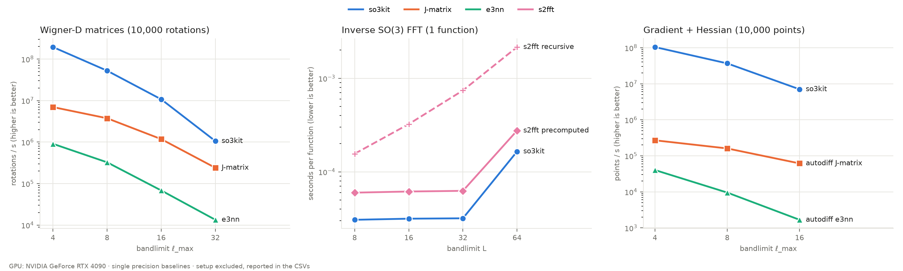

# so3kit

Fast harmonic analysis on the rotation group SO(3) in PyTorch, with Numba CUDA kernels:

- **Wigner-D matrices** for large batches of rotations, computed on the GPU
- **SO(3) FFT**: evaluate a bandlimited function on an Euler-angle grid
- **Analytic gradients and Hessians** of bandlimited functions on SO(3), for Newton-type optimization over rotations

so3kit grew out of [Matcha](https://github.com/swing-research/Matcha), a method for fast 3D rotational
alignment of volumes in cryo-electron tomography ([paper](https://arxiv.org/abs/2603.15285)).



## Install

```bash
pip install git+https://github.com/fabian-kruse/so3kit
```

Requires Python ≥ 3.12, PyTorch and a CUDA 12 GPU. `numpy` and `cuda-core` are capped in `pyproject.toml`
until numba-cuda supports their newest releases.

## Quickstart

A batch of functions f(α, β, γ) = Re Σᵢ cᵢ Dᵢ(α, β, γ), in ZYZ Euler angles:

```python
import torch
from so3kit import SO3Function, WignerDsize

ell_max, batch = 16, 4
coeffs = torch.randn(batch, WignerDsize(0, ell_max, ell_max), dtype=torch.complex64).cuda()
f = SO3Function(coeffs, ell_max, num_points=1)

values, (alphas, betas, gammas) = f.grid()      # SO(3) FFT on an equiangular grid

alpha, beta, gamma = (torch.rand(batch, 1).cuda() for _ in range(3))
f(alpha, beta, gamma)                           # values, (batch, num_points)
grad, hess = f.grad_hess(alpha, beta, gamma)    # (batch, num_points, 3), (batch, num_points, 3, 3)
```

[`examples/maximize.py`](examples/maximize.py) finds the maximum of a function on SO(3) with a grid search
followed by Newton steps.

## Backends and precision

On CUDA, so3kit uses fused kernels by default: one kernel per Wigner-D call, one for the value, gradient and
Hessian (D is never stored), and one for the inverse SO(3) FFT. The original step-by-step kernels remain
available as `backend="legacy"`.

```python
from so3kit import WignerDMatrices, SOFFT

D = WignerDMatrices(ell_max, precision="float64")   # default; "float32" is faster
D = WignerDMatrices(ell_max, backend="legacy")      # step-by-step kernels, float64
F = SOFFT(L, backend="legacy")                      # default: fused on CUDA, legacy on CPU
```

- `precision="float64"` evaluates the recursion coefficients in float64; with it, both backends return
  bitwise-identical D. `precision="float32"` needs the fused backend.
- The fused Wigner-D backend supports ℓ_max ≤ 63; above that, and for `mode="eval"`, so3kit uses the legacy
  kernels automatically.
- Set `SO3KIT_FAST_LAUNCH=0` to launch kernels through Numba instead of the prebuilt fast path (same results).

## Conventions

Coefficients are ordered as `[(ℓ, m′, m) for ℓ in 0..ℓ_max for m′ in -ℓ..ℓ for m in -ℓ..ℓ]`, the same as
[`spherical`](https://github.com/moble/spherical); `WignerDindex(ℓ, m′, m)` gives the position.

## Benchmarks

On one NVIDIA RTX 4090, against the strongest variant of each baseline that we could check for correctness.
so3kit is timed at its default precision; baselines run in single precision. Setup (tables, precomputes, JIT)
is excluded for everyone and reported in [`benchmarks/results/`](benchmarks/results).

| Task | Baseline | so3kit speed-up |
|---|---|---|
| Wigner-D, 10,000 rotations, ℓ_max = 4 … 32 | J-matrix method (e3nn 0.4 / fairchem), GPU | 28× … 4.4× |
| Gradient + Hessian, 10,000 points, ℓ_max = 4 … 16 | batched reverse-mode autodiff through the J-matrix method | 390× … 110× |
| Inverse SO(3) FFT, L = 8 … 64, 1 function | [s2fft](https://github.com/astro-informatics/s2fft) precomputed kernel (real signals) | 1.7× … 2.0× |
| Inverse SO(3) FFT, L = 8 … 64, 16 functions | same | 1.0× … 2.6× (level at L = 32) |

Also measured: [e3nn](https://github.com/e3nn/e3nn)'s `o3.wigner_D` (slower than the J-matrix method), three
autodiff styles through e3nn and the J-matrix method, four s2fft transforms, and the CPU reference
[spherical](https://github.com/moble/spherical). All rows are in the CSVs.

```bash
pip install -r benchmarks/requirements.txt
bash benchmarks/run_all.sh        # writes benchmarks/results/*.csv and benchmarks/benchmarks.png
python benchmarks/check_baselines.py   # correctness of every baseline
```

Notes on comparability: e3nn and the J-matrix method work in the real basis, and s2fft samples a different
grid (L × (2L−1) × (2L−1) points instead of so3kit's 2L × 2L × 2L), so the comparisons are of time for the same
task and bandlimit, not of identical outputs. Per grid point, so3kit's SO(3) FFT advantage is about twice the
ratio in the table. Accuracy is measured against `spherical` in float64.

## Tests

```bash
pytest            # GPU tests skip automatically without CUDA
```

## Citation

If you use so3kit, please cite:

```bibtex
@article{kruse2026matcha,
  title   = {Fast Volume Alignment by Frequency-Marched Newton Method},
  author  = {Kruse, Fabian and Debarnot, Valentin and Kishore, Vinith and Dokmani{\'c}, Ivan},
  journal = {arXiv preprint arXiv:2603.15285},
  year    = {2026}
}
```

## Acknowledgements

The Wigner-D recursion is adapted from [`spherical`](https://github.com/moble/spherical) by Mike Boyle
(MIT). The J-matrix baseline in `benchmarks/jmatrix_wigner.py` and `benchmarks/fairchem_Jd.pt` follows
[fairchem](https://github.com/facebookresearch/fairchem) (MIT), which took it from e3nn 0.4.0. See
[THIRD_PARTY_NOTICES](THIRD_PARTY_NOTICES).

## License

MIT
